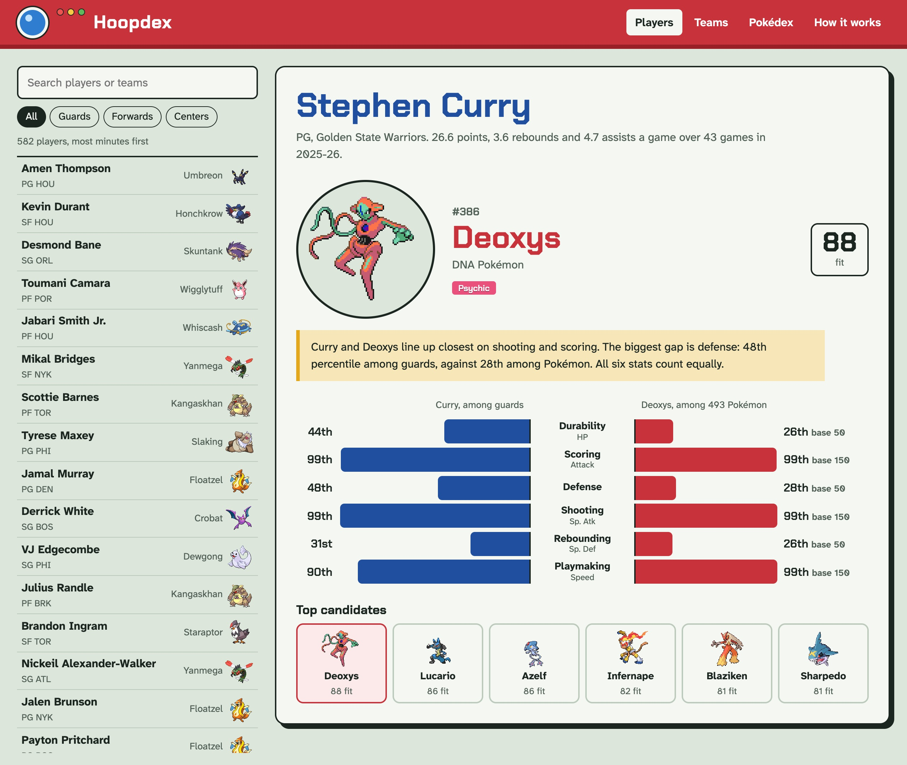
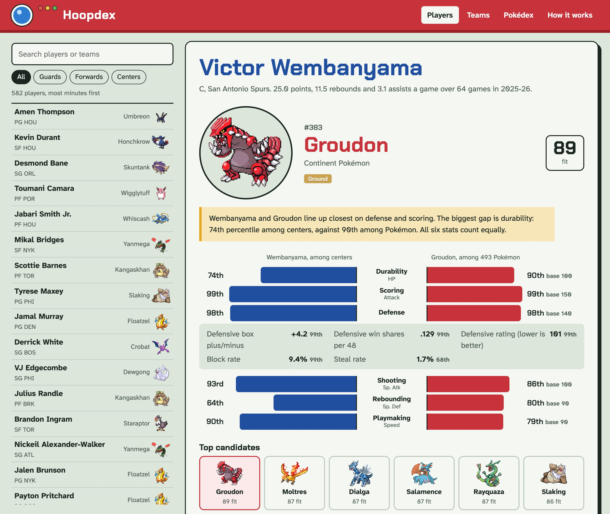
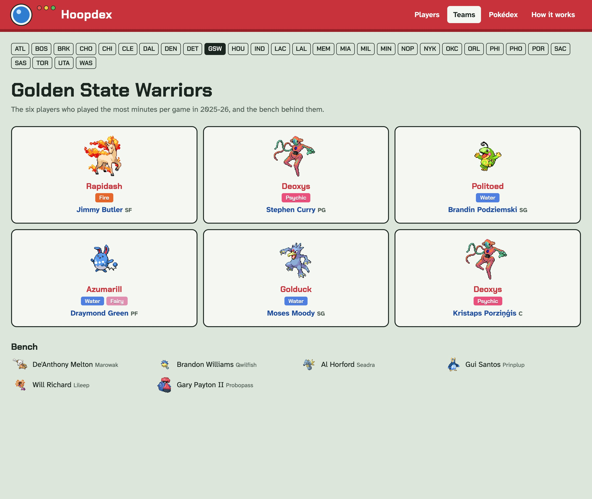
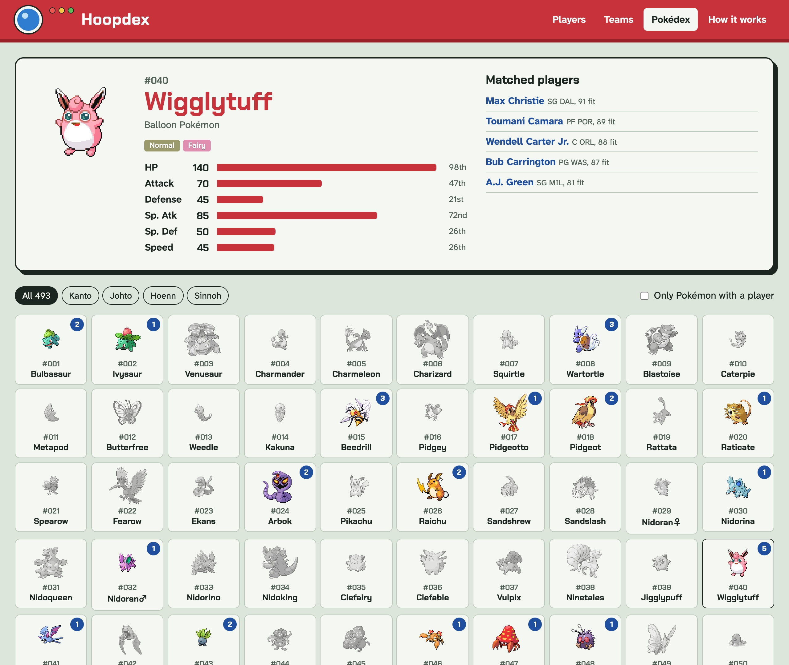
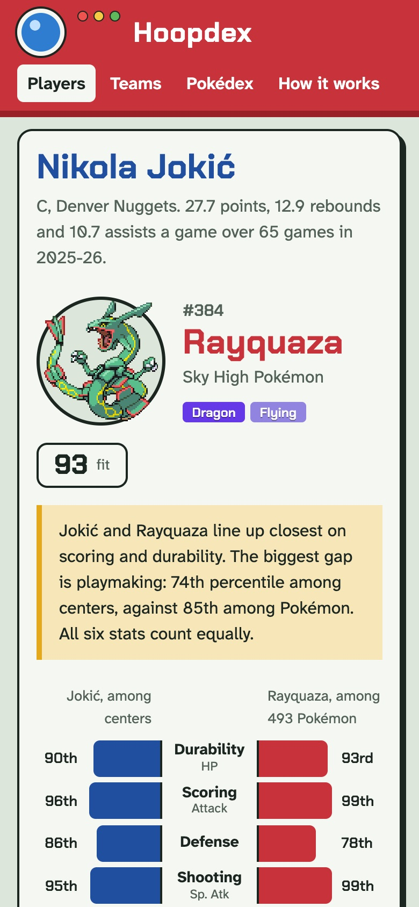

# hoopdex

Every NBA player matched to the Pokémon that plays like them, from Bulbasaur to Arceus.

**[Open it in your browser](https://nakulpatel0306.github.io/hoopdex/)**



Hoopdex turns a player's advanced stats and a Pokémon's base stats into percentiles, then
finds the Pokémon whose six stats line up closest with the player's. Curry, elite at scoring,
shooting and playmaking and average on defense, gets Deoxys. Jokić gets Rayquaza. It's
free, needs no account, and runs entirely in your browser.

## How a player becomes a Pokémon

Each Pokémon stat stands for a basketball skill:

| Pokémon stat | Basketball skill | Measured by                                                              |
| ------------ | ---------------- | ------------------------------------------------------------------------ |
| HP           | Durability       | Minutes played                                                           |
| Attack       | Scoring          | Points per 100 possessions, usage rate                                   |
| Defense      | Defense          | Defensive box plus/minus, defensive win shares per 48, defensive rating, block rate, steal rate |
| Sp. Atk      | Shooting         | True shooting, threes per 100 possessions                                |
| Sp. Def      | Rebounding       | Defensive and offensive rebound rate                                     |
| Speed        | Playmaking       | Assist rate, turnover rate                                               |

1. **Players are ranked against their position.** Every player with 500+ minutes is ranked
   against the other guards, forwards or centers, so a forward in the 67th percentile on
   defense defends better than two thirds of forwards. Centers aren't marked down for not
   passing like point guards. Skills with several metrics average their ranks, then rank
   that average so it still runs from 1st to 99th.
2. **Pokémon are ranked against the whole Pokédex.** All 493 gen 1-4 Pokémon are ranked on
   each base stat.
3. **The closest Pokémon on all six stats wins.** Every stat counts equally, and the gap is
   a root mean square, so one big miss costs more than several small ones. The fit score is
   100 minus that gap: a 90 means the two sit within about ten percentile points everywhere.

Each card says where the pair line up closest and where they differ most. Tap any row of
the chart to see the raw metrics behind it, or pick one of the next closest Pokémon to
compare.



## Teams and the Pokédex

**Teams** shows every roster as a six-Pokémon party: the six players with the most minutes
per game, and the bench behind them.



**Pokédex** goes the other way: all 493 Pokémon, filterable by region, each showing which
players landed on it. Pokémon nobody matched are greyed out.



It works on a phone too.



## Run it yourself

```sh
bun install
bun dev
```

The data is a snapshot in `src/data`, so there's no server or API key. To refresh it:

```sh
bun run snapshot
```

That pulls the latest season from Basketball-Reference (four requests, spaced to stay under
its rate limit) and the gen 1-4 Pokédex from PokeAPI's GraphQL API. stats.nba.com blocks
requests that don't come from a browser, which is why player stats come from
Basketball-Reference.

`bun test` checks the percentile math and that every player's match really is the closest
Pokémon in the Pokédex.

## Data

- Player stats: the 2025-26 regular season from
  [Basketball-Reference](https://www.basketball-reference.com/). Teams are where each player
  has played in 2026-27, or their last 2025-26 team. Rookies appear once they have a season
  of minutes.
- Pokémon stats, names and Platinum sprites: [PokeAPI](https://pokeapi.co/). Base stats
  reflect the latest games, so a few early Pokémon carry their Generation VI boosts.

Pokémon is © Nintendo, Game Freak and The Pokémon Company. Hoopdex is an unofficial fan
project and isn't affiliated with them or the NBA.

## License

MIT
