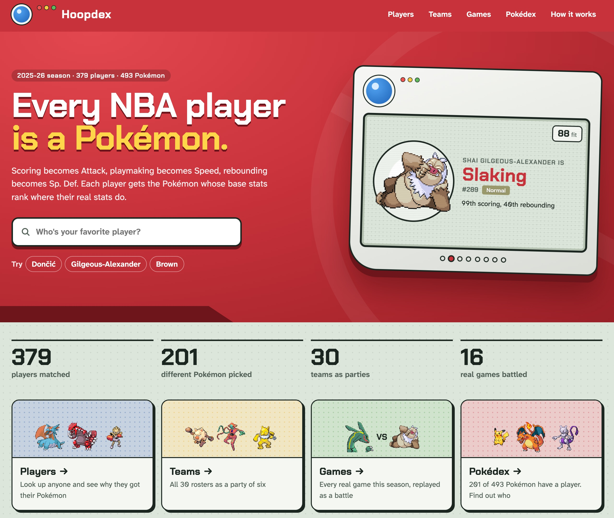
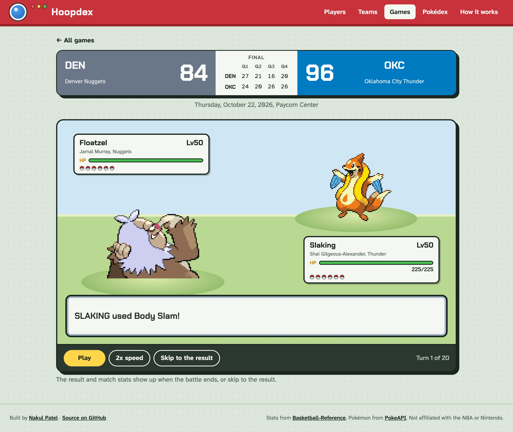
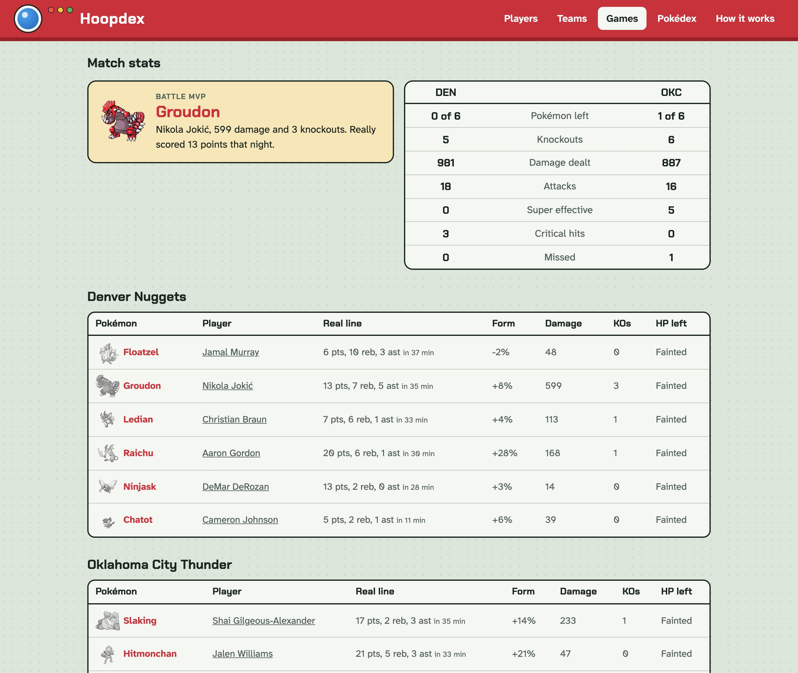

# hoopdex

Every NBA player matched to the Pokémon that plays like them, from Bulbasaur to Arceus.

**[Open it in your browser](https://nakulpatel0306.github.io/hoopdex/)**



Hoopdex turns a player's advanced stats and a Pokémon's base stats into percentiles, then
finds the Pokémon whose six stats line up closest with the player's. Curry, elite at scoring,
shooting and playmaking and average on defense, gets Deoxys. Jokić and Wembanyama both get
Groudon. It's free, needs no account, and runs entirely in your browser.


## How a player becomes a Pokémon

Each Pokémon stat stands for a basketball skill:

| Pokémon stat | Basketball skill | Measured by                                                              |
| ------------ | ---------------- | ------------------------------------------------------------------------ |
| HP           | Durability       | Minutes played                                                           |
| Attack       | Scoring          | Points per 100 possessions, usage rate                                   |
| Defense      | Defense          | Defensive box plus/minus, defensive win shares per 48, defensive rating, block rate, steal rate |
| Sp. Atk      | Shooting         | True shooting, threes per 100 possessions                                |
| Sp. Def      | Rebounding       | Defensive and offensive rebound rate                                     |
| Speed        | Playmaking       | Assist rate, turnover rate                                               |

1. **Players are ranked against their position.** Every player with 500+ minutes is ranked
   against the other guards, forwards or centers, so a forward in the 67th percentile on
   defense defends better than two thirds of forwards. Centers aren't marked down for not
   passing like point guards. Skills with several metrics take a weighted average of their
   ranks, then rank that average so it still runs from 1st to 99th.
2. **Pokémon are ranked against the whole Pokédex.** All 493 gen 1-4 Pokémon are ranked on
   each base stat.
3. **Steadier numbers count for more.** Each metric is weighted by how well it holds up from
   one season to the next for the same players, and so is each of the six stats in the match.
   Assist rate and rebound rates are steady and count the most; true shooting and minutes
   played (injuries) swing more and count less. See the weights below.
4. **The closest Pokémon on all six stats wins.** All six always count, and the gap is a
   weighted root mean square, so one big miss costs more than several small ones. The fit
   score is 100 minus that gap: a 90 means the two sit within about ten percentile points.

The weights are fitted by `scripts/reliability.ts` and were only kept because they beat equal
weighting in a backtest. Fitted on one pair of seasons and tested on another, both ways round:

| Test seasons | Profile drift, equal → weighted | Match still top 10 a year later |
| ------------ | ------------------------------- | ------------------------------- |
| 2024-25 → 2025-26 | 21.70 → 21.04 | 35.4% → 35.7% |
| 2023-24 → 2024-25 | 20.04 → 19.39 | 38.5% → 41.1% |

Lower drift means a player's profile moves less between seasons that the weights never saw.
The weighted profiles were steadier in every one of 2,000 bootstrap resamples, both ways.

Each card says where the pair line up closest and where they differ most. Tap any row of
the chart to see the raw metrics behind it, or pick one of the next closest Pokémon to
compare.


## Games

**Games** replays every real 2026-27 game as a Pokémon battle. Each team fields the six
players who played the most minutes that night, as their Pokémon, and each Pokémon hits
harder or softer with its player's real Game Score. The battle runs on Gen IV rules (level 50
stats, the type chart, STAB, critical hits, the damage roll), is seeded by the game so it
always plays out the same, and ends with match stats, a battle MVP and how the real game
went. The page keeps a running count of how often the battle went the same way as the game.





## Teams and the Pokédex

**Teams** shows every roster as a six-Pokémon party: the six players with the most minutes
per game, and the bench behind them.


**Pokédex** goes the other way: all 493 Pokémon, filterable by region, each showing which
players landed on it. Pokémon nobody matched are greyed out.


It works on a phone too.


## Run it yourself

```sh
bun install
bun dev
```

The data is a snapshot in `src/data`, so there's no server or API key. To refresh it:

```sh
bun run snapshot
```

That pulls the latest season from Basketball-Reference (four requests, spaced to stay under
its rate limit) and the gen 1-4 Pokédex from PokeAPI's GraphQL API. stats.nba.com blocks
requests that don't come from a browser, which is why player stats come from
Basketball-Reference.

```sh
bun run games     # this season's results and box scores into public/games.json
bun run weights   # refit and backtest the weights; add --write to save them
```

`bun run games` only fetches games it doesn't have yet. The Pages workflow runs it every
morning, so the site picks up the night's games on its own.

`bun test` checks the percentile math, the weights, that every player's match really is the
closest Pokémon, and the battle engine (type chart, stat formulas, lineups, and that a game
always replays the same).

## Data

- Player stats: the 2025-26 regular season from
  [Basketball-Reference](https://www.basketball-reference.com/). Teams are where each player
  has played in 2026-27, or their last 2025-26 team. Rookies appear once they have a season
  of minutes.
- Games: 2026-27 results, line scores and box scores from Basketball-Reference. The weights
  were fitted on its 2023-24, 2024-25 and 2025-26 seasons.
- Pokémon stats, names and Platinum sprites: [PokeAPI](https://pokeapi.co/). Base stats
  reflect the latest games, so a few early Pokémon carry their Generation VI boosts.

Pokémon is © Nintendo, Game Freak and The Pokémon Company. Hoopdex is an unofficial fan
project and isn't affiliated with them or the NBA.

## License

MIT
